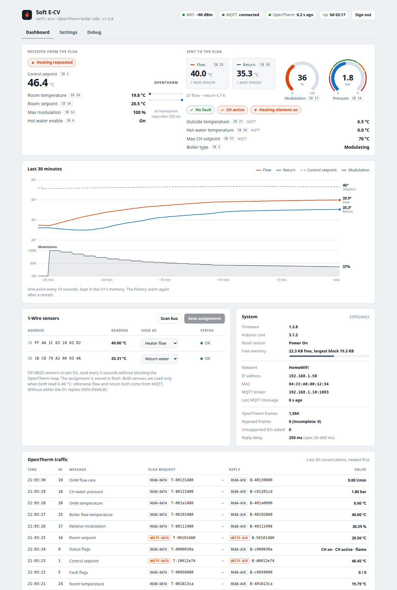
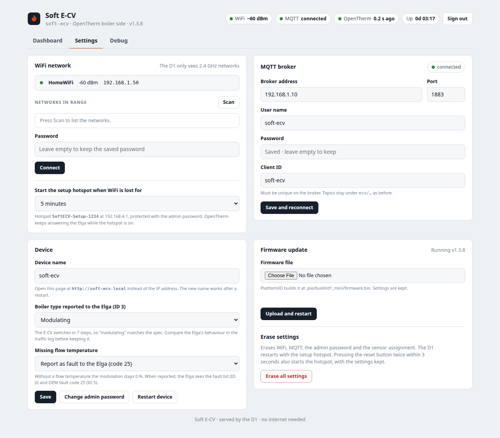
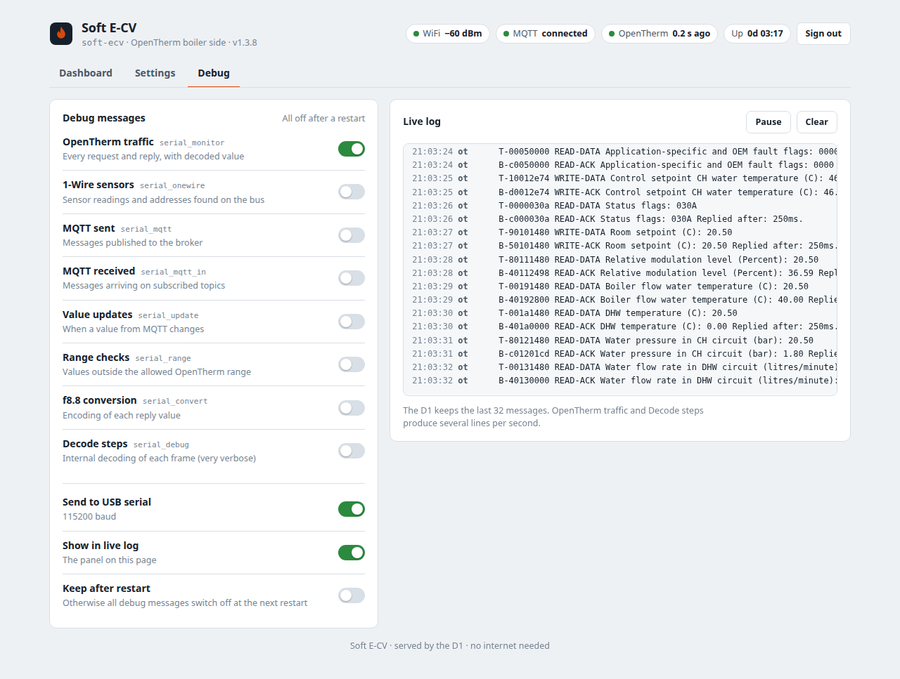
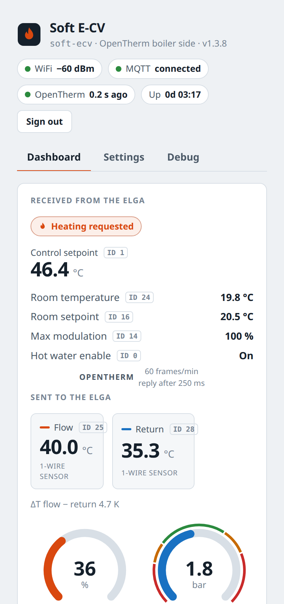
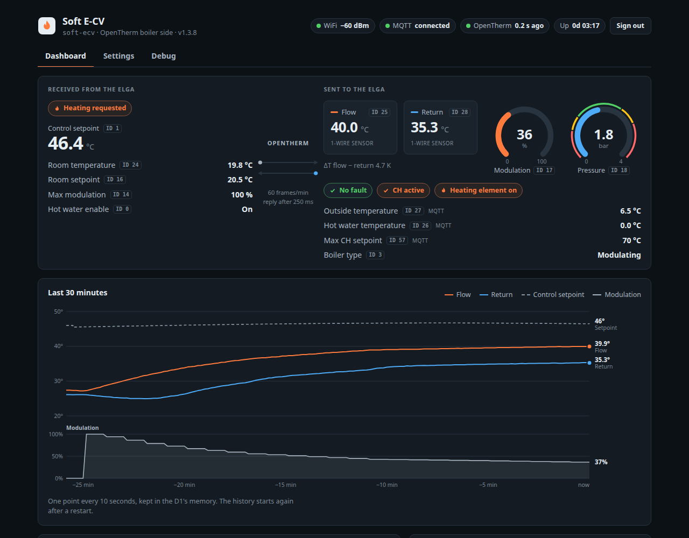

# Soft E-CV

**An OpenTherm boiler in software: it lets a hybrid heat pump control a simple electric boiler.**

Soft E-CV runs on a Wemos D1 mini (ESP8266) and acts as the *boiler side* of an OpenTherm connection. The heat pump talks to it as if it were a modulating central heating boiler. Soft E-CV answers by the book (OpenTherm Protocol Specification v2.2) and passes the requested power on via MQTT to a home automation system, which switches an electric boiler in seven power steps.



* **Spec-conform OpenTherm follower.** Reply types, timing (250 ms after the request, allowed 20–800 ms), parity checks, UNKNOWN-DATAID for unsupported data-ids, fault reporting.
* **Web interface on the D1 itself.** Live values in both directions, a 30-minute trend, the OpenTherm traffic, 1-Wire sensor assignment, settings and a live debug log. No internet or cloud needed, light and dark theme, works on a phone.
* **Setup without editing code.** On first start the D1 opens a WiFi hotspot with a setup wizard for WiFi, MQTT and the admin password. Firmware updates go through the web page.
* **Verifiable.** `tools/ot_check.py` tests every data-id against the specification and can follow and check the live conversation with the heat pump.

## Try the demo

**[The demo](https://marioschouten.github.io/Soft-ECV/demo.html)** is the real web interface of the D1, running in your browser with a simulated heating cycle: the Elga asks for heat, Soft E-CV calculates the modulation every minute as the firmware does, the power level steps down as the water warms up, and the Elga's OpenTherm conversation scrolls by once per second, with correct frames. All tabs work, settings can be changed (they are not saved), and nothing is sent anywhere.

The demo is served by GitHub Pages from the `docs` folder. Add `#settings` or `#debug` to the address to open that tab, for example [the debug tab](https://marioschouten.github.io/Soft-ECV/demo.html#debug). It also works offline: download [docs/demo.html](docs/demo.html) and open it in a browser, no server or internet connection needed.

The screenshots in this README are taken from the demo. The demo is rebuilt from `web/index.html` and `web/demo-mock.js` on every firmware build (or with `python3 tools/build_demo.py`), so it always shows the current interface.

## Background: our installation

Our installation is a Honeywell Chronotherm Touch Modulation thermostat connected to an Elga hybrid heat pump. The Elga is the OpenTherm master. Its OpenTherm boiler output, normally connected to a gas boiler, is connected to Soft E-CV instead.

The "boiler" is a 9 kW Mini Europe+ electric central heating unit (E-CV) with a Wilo Yonos Para 15/7 pump, piped in parallel with the Elga. It is an on/off type, modified with solid state relays that switch its three heating coils in different combinations to give **seven power levels**.

```
Thermostat ──OpenTherm──▶ Elga heat pump ──OpenTherm──▶ Soft E-CV (D1 mini) ──MQTT──▶ OpenHAB ──SSR──▶ E-CV, 7 levels
```

Soft E-CV publishes the requested modulation on MQTT. OpenHAB turns it into a power level and reports back whether the E-CV is heating. The first version was built in 2020. In 2026 it was rewritten as version 1.3 with a web interface, setup hotspot and a full check against the OpenTherm specification.

This software was developed for this single project and is shared for information. Please read the disclaimer at the end.

## Hardware

| Part | Notes |
|---|---|
| Wemos D1 mini (ESP8266, 4 MB flash) | A "D1 mini Lite" (1 MB) is too small for updates via the web page |
| Ihor Melnyk's OpenTherm Slave Shield / adapter | OpenTherm in on **D6** (GPIO12), out on **D7** (GPIO13) |
| 2× DS18B20 1-Wire temperature sensor | Flow and return water, on **D3** with a 4.7 kΩ pull-up to 3.3 V |

## Getting started

1. Build and flash with [PlatformIO](https://platformio.org/) (`pio run -t upload`). The web page in `web/index.html` is compressed into the firmware automatically.
2. On first start the D1 opens the WiFi hotspot **SoftECV-Setup-xxxx**. Join it with a phone or laptop; the setup page opens by itself, or go to http://192.168.4.1.
3. Choose your WiFi network, enter the MQTT broker and set the admin password (user `admin`).
4. Open the web interface at http://soft-ecv.local or at the IP address shown at the end of the setup.

The hotspot also starts when WiFi has been lost for 5 minutes (adjustable), and when the reset button is pressed twice within 3 seconds. From then on it is protected with the admin password. OpenTherm keeps answering the whole time.

The blue LED on the D1 blinks while the setup hotspot is on and stays on while connected to WiFi.

**Updating:** Settings → Firmware update → choose the `.bin` file from [Releases](https://github.com/marioschouten/Soft-ECV/releases), or your own build in `.pio/build/d1_mini/firmware.bin`. Settings are kept. A D1 running version 1.2.x (with ElegantOTA) can be updated to 1.3 through its ElegantOTA page. It then starts with the setup hotspot, because the settings moved from `settings.h` to flash.

## Web interface

| | |
|---|---|
|  |  |
| **Settings:** WiFi, MQTT broker, device name, boiler type reported on ID 3, fault reporting, firmware update. | **Debug:** switch the debug messages on and off, live log on the page and/or the USB serial port (115200 baud). |

<p>


</p>

* **Dashboard:** what the heat pump asks for (heat demand, control setpoint, room temperature and setpoint, maximum modulation) and what Soft E-CV reports back (flow and return temperature, modulation, pressure, status). It also shows a 30-minute trend, the 1-Wire sensors, system status and the last OpenTherm conversations, decoded.
* **1-Wire sensors:** scan the bus and assign the flow and return sensor. The assignment is stored in flash, so there are no sensor addresses in the code any more.
* Values are visible to anyone on the network. Changing settings requires signing in.

## How it works

### Modulation and power levels

Every 60 seconds Soft E-CV compares the control setpoint from the heat pump (ID 1) with the flow temperature:

| Setpoint − flow | Modulation |
|---|---|
| more than 20 °C | 100 % |
| 2–20 °C | difference / 18 × 100 % |
| less than 2 °C | 0 % |

The result is capped by the maximum modulation from the heat pump (ID 14) and from MQTT, reported on ID 17 and published on `ecv/thermostat/modulation`. Our OpenHAB rule maps it to the power level of the E-CV, where level 1 is the full 9 kW:

| Modulation | 0 | 0–15 % | 15–30 % | 30–43 % | 43–57 % | 57–71 % | 71–86 % | 86–100 % |
|---|---|---|---|---|---|---|---|---|
| Power level | off | 7 | 6 | 5 | 4 | 3 | 2 | 1 |

### Temperatures and fault reporting

The two 1-Wire sensors are used **as a pair**, and only when both read between 0 and 60 °C. A broken DS18B20 typically reads −127 °C (no answer) or 85 °C (its power-on value). Otherwise flow and return both come from MQTT (`ecv/sensors/heater_flow_temperature` and `return_water_temperature`).

Without any flow temperature the modulation stays 0 %, so the E-CV is never switched on blind. Like a real boiler with a sensor fault, Soft E-CV then reports a fault to the heat pump: the fault bit in ID 0 and **OEM fault code 25** in ID 5. The Elga and the thermostat show this fault. This can be switched off under Settings → Device.

### OpenTherm

Soft E-CV follows the OpenTherm Protocol Specification v2.2:

* The reply type follows the request type. Data-ids the E-CV does not have get UNKNOWN-DATAID, and frames with a parity error are not answered.
* The reply is sent 250 ms after the request (allowed 20–800 ms). Version 1.2.3 sometimes needed 860 ms for the status reply.
* Values that are not available get DATA-INVALID, for example the flow temperature (ID 25) when no sensor works.
* ID 3 reports the boiler as on/off (as in version 1.2.3) or modulating, selectable in the settings. ID 15 reports 9 kW with a minimum modulation of 14 % (one of seven steps).

Supported data-ids:

| ID | | ID | |
|---|---|---|---|
| 0 | Status (fault, CH mode, flame) | 24 | Room temperature |
| 1 | Control setpoint | 25 | Boiler flow temperature |
| 2 | Master configuration | 26 | DHW temperature |
| 3 | Slave configuration (on/off or modulating) | 27 | Outside temperature |
| 5 | Fault flags and OEM fault code | 28 | Return water temperature |
| 14 | Maximum relative modulation | 48, 49 | DHW and max CH setpoint bounds |
| 15 | Capacity 9 kW, minimum modulation 14 % | 56 | DHW setpoint |
| 16 | Room setpoint | 57 | Max CH water setpoint |
| 17 | Relative modulation | 124, 125 | OpenTherm version (2.2) |
| 18, 19 | CH water pressure, DHW flow rate | 126, 127 | Product type and version |

**One deliberate deviation:** the Elga sends the room temperature (ID 24) as a READ-DATA with the temperature in the data field, while the specification defines ID 24 as write-only. The Elga keeps asking after an UNKNOWN-DATAID, so Soft E-CV stores the value and returns it as READ-ACK. The checker reports this as a warning, not a failure.

The Elga asks for 11 data-ids in a fixed cycle, one per second: 18, 19, 56, 24, 5, 1, 0, 16, 17, 25, 26.

## MQTT

The topics are the same as in version 1.2.3, so existing automations keep working. Values are numbers in the format `0.00`, for example `75.00` or `25.34`.

**Published by Soft E-CV**

| Topic | Description |
|---|---|
| `ecv/thermostat/ch_requested` | Heat demand from the heat pump (0/1), on change and every 60 s |
| `ecv/thermostat/modulation` | Modulation reported on ID 17 |
| `ecv/thermostat/ch_setpoint` | Control setpoint from the heat pump (ID 1) |
| `ecv/thermostat/boilertemp` | Flow sensor temperature |
| `ecv/thermostat/returntemp` | Return sensor temperature, every 5 s |
| `ecv/thermostat/rawdata/rx`, `rawdata/tx` | Every OpenTherm request and reply as text |
| `ecv/thermostat/rawdata/modulation` | The modulation calculation, every 60 s |
| `ecv/thermostat/rawdata/test` | Reply to a test frame sent on `ecv/rawdata/command` |
| `ecv/system` | `E-CV is ONLINE` / `E-CV is OFFLINE` (retained; OFFLINE is the MQTT last will) |

**Status, set by the home automation**

| Topic | Default | Description |
|---|---|---|
| `ecv/status/fault` | 0 | Fault: ID 0 fault bit and ID 5 "service request" |
| `ecv/status/ch_mode` | 0 | Central heating active |
| `ecv/status/flame` | 0 | Heating element on |

When `ecv/thermostat/ch_requested` goes from 0 to 1, our OpenHAB system sets the power level from `ecv/thermostat/modulation` and sends `ecv/status/ch_mode = 1` and `ecv/status/flame = 1`, so the heat pump knows the E-CV is heating. DHW, cooling and CH2 are not supported.

**Commands and sensor values**

| Topic | Default | Description |
|---|---|---|
| `ecv/command/max_rel_modulation` | 100 | Upper limit for the reported modulation |
| `ecv/command/max_ch_water_setpoint` | 70 | ID 57 |
| `ecv/command/dhw_setpoint` | 65 | ID 56 |
| `ecv/sensors/heater_flow_temperature` | – | Used when the 1-Wire sensors are not both reading 0–60 °C |
| `ecv/sensors/return_water_temperature` | – | Used when the 1-Wire sensors are not both reading 0–60 °C |
| `ecv/sensors/water_pressure_ch` | 2.00 | ID 18 |
| `ecv/sensors/outside_temperature` | 0 | ID 27 |
| `ecv/sensors/water_flow_dhw` | 0 | ID 19 |
| `ecv/sensors/dhw_temperature` | 0 | ID 26 |

## Testing

`tools/ot_check.py` checks the OpenTherm replies against the v2.2 specification. It covers parity, reply types, mandatory data-ids, value ranges, read/write direction and timing.

* `selftest --port <serial port>` (USB) or `selftest --host <ip> --password <admin password>` sends test frames for every data-id and checks the replies. Test frames are not sent on the OpenTherm line. Current result: 297 checks passed, 0 failed, and 2 warnings (the ID 24 deviation).
* `live --host <ip> [--minutes N]` follows the real conversation with the heat pump, checks every frame and saves it in `captures/`.
* `analyse <capture file>` checks a saved capture again.

For the USB link use PlatformIO's Python, which has pyserial: `~/.platformio/penv/bin/python tools/ot_check.py selftest --port /dev/ttyUSB0`.

A single frame can also be tested over MQTT: send 8 hex characters to `ecv/rawdata/command`. The reply is published on `ecv/thermostat/rawdata/test`.

## Source

| File | |
|---|---|
| `src/boiler.cpp` | OpenTherm follower: replies, modulation, frame recorder, MQTT values |
| `src/sensors.cpp` | DS18B20 sensors, read without blocking the OpenTherm loop |
| `src/net.cpp` | WiFi, setup hotspot, MQTT, LED |
| `src/web.cpp`, `web/index.html` | Web interface and its API |
| `web/demo-mock.js`, `tools/build_demo.py` | Simulated API and heating cycle for `docs/demo.html` |
| `src/config.cpp` | Settings in flash (replaces `settings.h`) |
| `tools/ot_check.py` | Specification checker |
| `legacy/main-v1.2.3.cpp` | The 2020 version, for reference |

## Version history

* **1.3** (2026): rewrite with web interface, setup hotspot, settings in flash, OTA updates via the web page, non-blocking sensors, OpenTherm v2.2 conformance, specification checker, fault reporting, protection against running out of memory under many simultaneous web requests.
* **1.2.3** (2020): original version, settings in `settings.h`, controlled via MQTT.

## Disclaimer

This software was developed for a single project and is shared for information only, without any guarantee or support. It controls a heating installation: test carefully and use at your own risk.

Released into the public domain, see [LICENSE](LICENSE).
